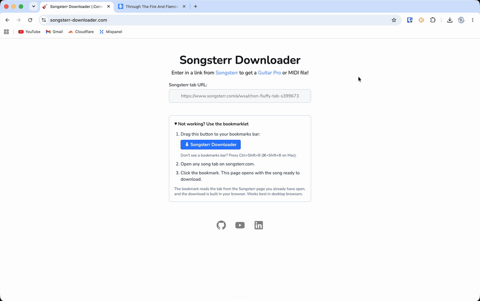

# Songsterr Downloader

Download any [Songsterr](https://www.songsterr.com) tab as a Guitar Pro (`.gp`) or MIDI file.

**Live at [songsterr-downloader.com](https://songsterr-downloader.com)** · See how I built it [here!](https://www.youtube.com/watch?v=SsIMY8xmDNY)



## Current status

In November 2026 Songsterr started blocking requests from our server (they answer with a `429` "Quick check" page). Pasting a Songsterr link into the site may therefore fail.

**The bookmarklet works.** It runs in your own browser on the Songsterr page you already have open, so our server never has to contact Songsterr.

## How to use it

1. Go to [songsterr-downloader.com](https://songsterr-downloader.com) and drag the **⬇ Songsterr Downloader** button to your bookmarks bar.
   Don't see a bookmarks bar? Press `Ctrl+Shift+B` (`⌘+Shift+B` on Mac).
2. Open any song tab on [songsterr.com](https://www.songsterr.com).
3. Click the bookmark. Songsterr Downloader opens with the song ready.
4. Click **Download Guitar Pro** or **Download MIDI**.

Bookmarklets work best in desktop browsers.

## How it works

1. **Bookmarklet** (runs on songsterr.com): reads the tab metadata Songsterr embeds in the page (song, revision, tracks) and opens the app with it in the URL fragment. The fragment is never sent to our server.
2. **App** (runs in your browser): validates the metadata, then fetches each track's revision JSON directly from Songsterr's CDN.
3. Converts all tracks into an [alphaTab](https://alphatab.net) score model.
4. Exports GP7 or MIDI in the browser and triggers the download.

Pasting a link still works where Songsterr doesn't block the server (for example local development). The server reads the same metadata from the page, and the download still happens in the browser.

## Conversion features

See [CONVERTER.md](src/lib/converter/CONVERTER.md) for full details.

## How to run

1. Clone the repo
2. Install [bun](https://bun.sh/)
3. `bun install`
4. `bun dev`

## Running tests

```
bun run test:unit
```
